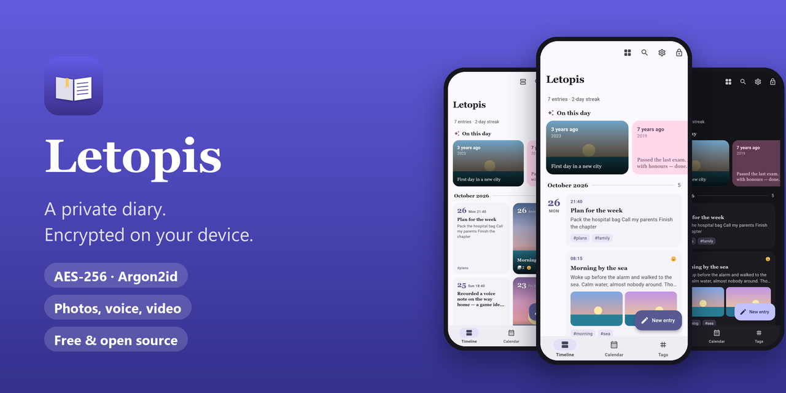
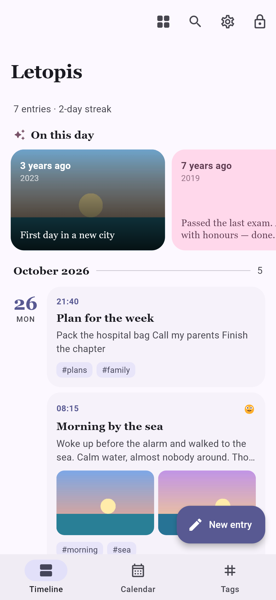
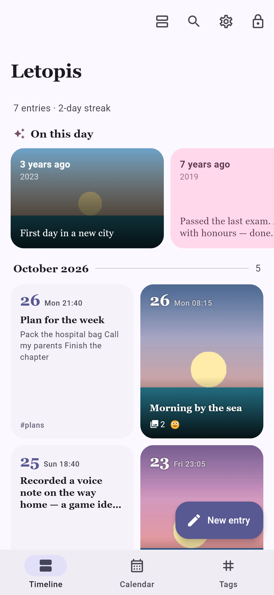
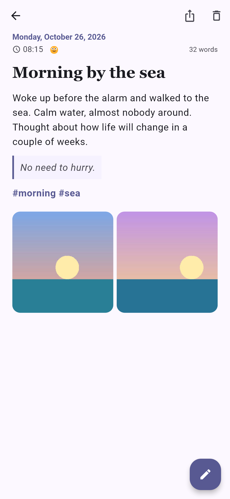
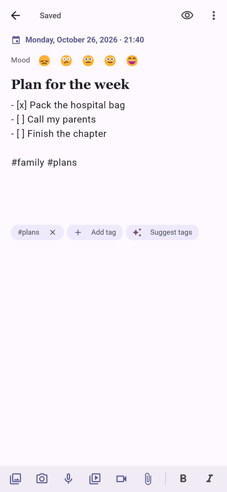
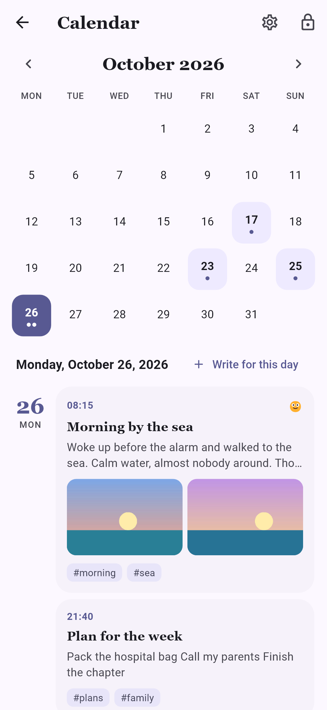
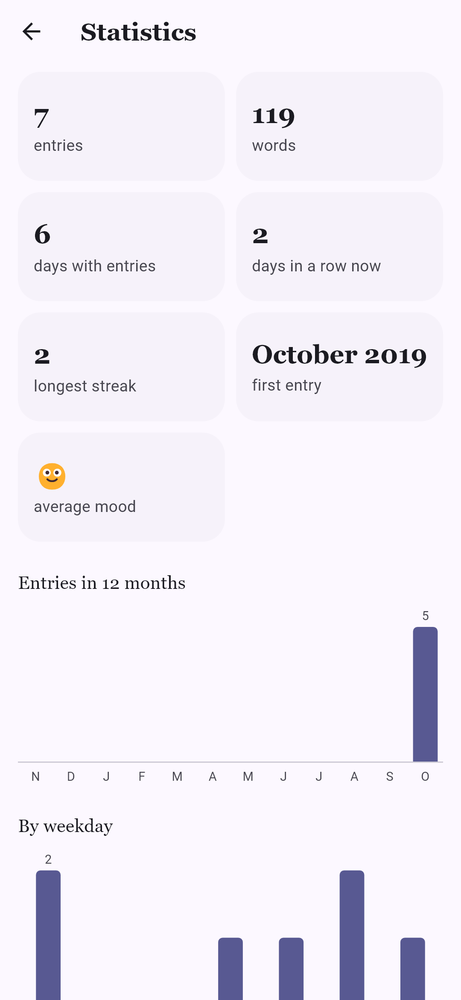
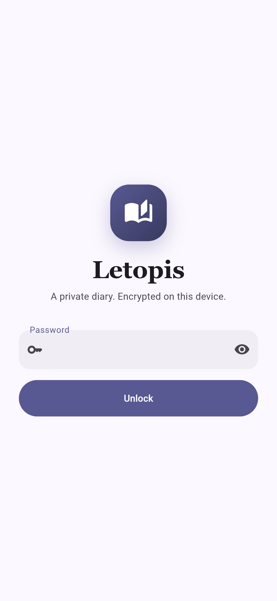
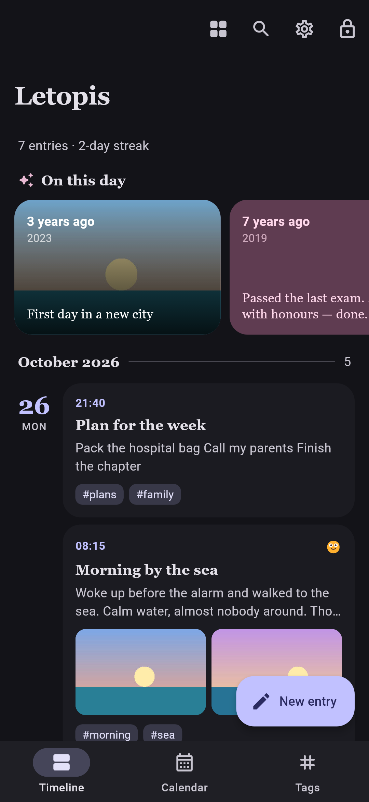

<div align="center">



**English** · [Русский](README.ru.md)

[](https://letopis.recalltwin.com)
[](#download)

[](LICENSE)


</div>

**Letopis** (Russian *«Летопись»*, "chronicle") is a personal diary for Android. Every entry is plain
Markdown with its time, tags, mood and attachments, and everything is encrypted on your phone with
a key derived from your password. No account, no cloud of ours, no ads, no analytics. Your diary stays
yours.

## Features

**Write**
- Markdown with headings, quotes and checklists; the time is set automatically.
- Photos, video, voice notes and any files, right inside an entry.
- Mood from 1 to 5; tags by hand, with hashtags, or suggested by AI if you want.

**Look back**
- A timeline of cards or a grid of tiles; *On this day* shows what you wrote years ago.
- Calendar, tags, full-text search and statistics: streaks, words, average mood.
- Trash keeps deleted entries for 30 days, with *Undo*.

**Privacy first**
- AES-256-GCM encryption, key from your password via Argon2id. Without the password the files are useless.
- Auto-lock, optional fingerprint unlock, optional screenshot blocking.
- The app goes online only when you ask it to: GitHub sync, AI tags, update check.

**Your data, your way**
- Optional sync through your own cloud — Yandex Disk, Mail.ru Cloud, Nextcloud or any WebDAV server — or a
  private GitHub repository: encrypted, both ways, across devices.
- Export to PDF: a book to read or print, with dates, formatting and photos; a whole year or one entry.
- Import from a text diary export, MyDiary or `.md` files; export everything to ZIP.
- English and Russian, light and dark themes, six accent colours.

## Screenshots

<div align="center">
<table>
  <tr>
    <td></td>
    <td></td>
    <td></td>
    <td></td>
  </tr>
  <tr>
    <td></td>
    <td></td>
    <td></td>
    <td></td>
  </tr>
</table>
</div>

## Download

| Where | Status | Android |
|---|---|---|
| **[letopis.recalltwin.com](https://letopis.recalltwin.com)** | ✅ latest APK; *Settings → Check for updates* | 9 and newer |
| **RuStore** | 🔜 coming soon | 7 and newer |
| **Google Play** | later | 7 and newer |

A new version installs over the old one and keeps your entries. The site and RuStore builds are signed
with the same key, so you can switch between them.

> [!IMPORTANT]
> The password cannot be recovered: that is the point of encryption. Keep it somewhere safe.

## How your data is protected

| | |
|---|---|
| **Encryption** | Argon2id turns your password into a key that unwraps a random data key; files are AES-256-GCM in 1 MiB chunks |
| **On the phone** | Entries, attachments, thumbnails, settings and the search index are all encrypted |
| **Sync** | The same encrypted files go to *your* cloud folder or private GitHub repository; neither sees the text |
| **Network** | Only your cloud or GitHub, the AI service you chose (HTTPS only, after consent) and the update check, each only on your action |
| **Updates** | Every build is signed with a key kept outside this repository |

Threat model and known limitations: [SECURITY.md](SECURITY.md).

## Build from source

```bash
flutter pub get
flutter test
flutter build apk --release --flavor site    # or --flavor rustore / --flavor play
```

Release builds need your own signing key in `android/key.properties`. The full guide (architecture,
build flavors, signing and key rotation, sync format) is in [docs/DEVELOPMENT.md](docs/DEVELOPMENT.md),
in Russian.

## Contributing

Bug reports and ideas are welcome in [Issues](../../issues), pull requests too. Please keep the rules
in [AGENTS.md](AGENTS.md): no weakening of encryption, no plaintext on disk, nothing sent over the network
without the user's action. Found a vulnerability? Email <sybberr@gmail.com> instead of opening a public
issue.

## License

[GPL-3.0](LICENSE), with an [additional permission](LICENSE-EXCEPTION.md) to link the RuStore payment SDK
in the RuStore build. © 2026 Alexander Bylinsky.

---

<div align="center">

## ❤️ Support the author

Letopis is free: no ads, no subscriptions, no paid features. Everything is available to everyone,
and it will stay that way. If the app is useful to you, you can say thank you with a one-off payment
of any amount.

[](https://pay.cloudtips.ru/p/16ad28d4)

In the app: *Settings → Support the project*. A payment unlocks nothing; it is just a thank-you.<br>
Free ways to help: ⭐ star the repository, tell a friend, report a bug.

</div>
