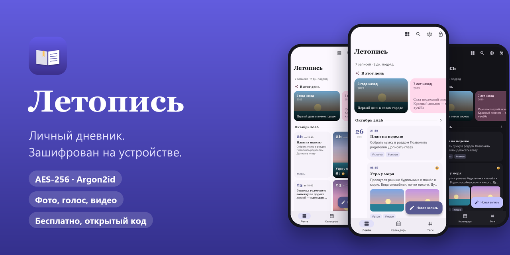
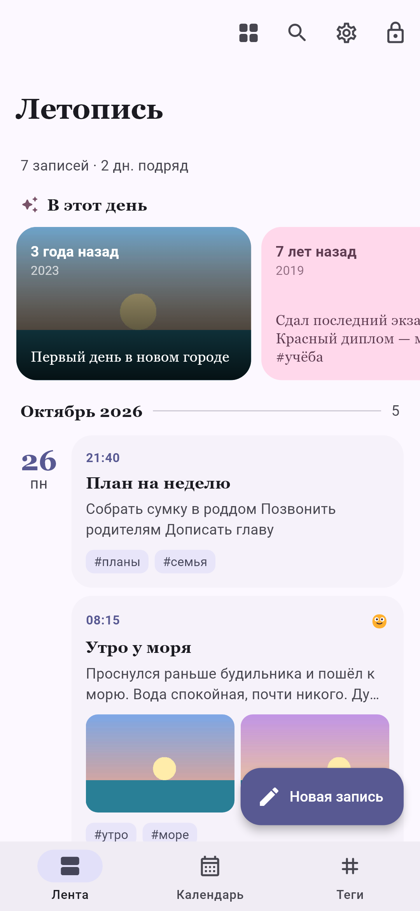
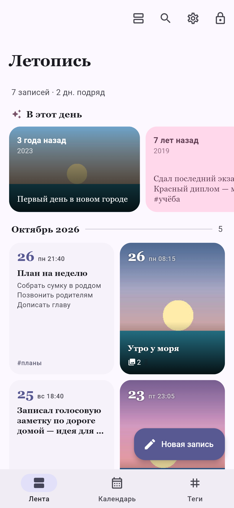
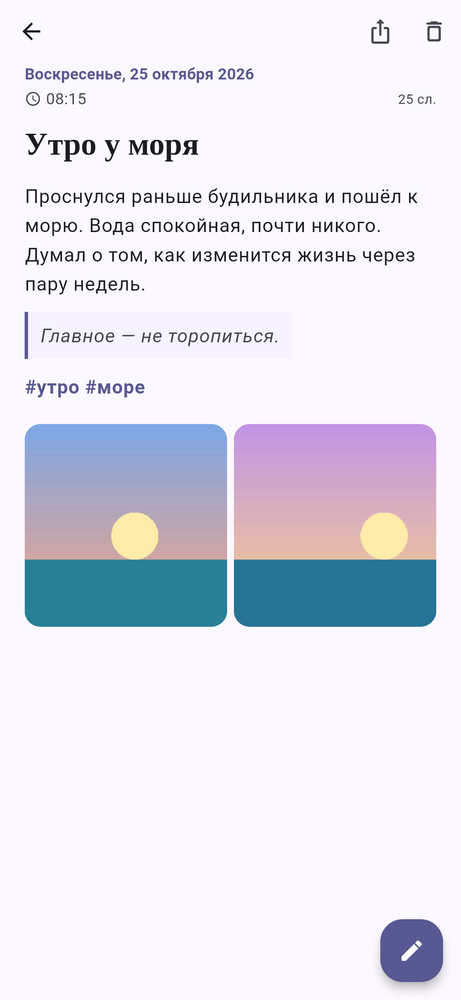
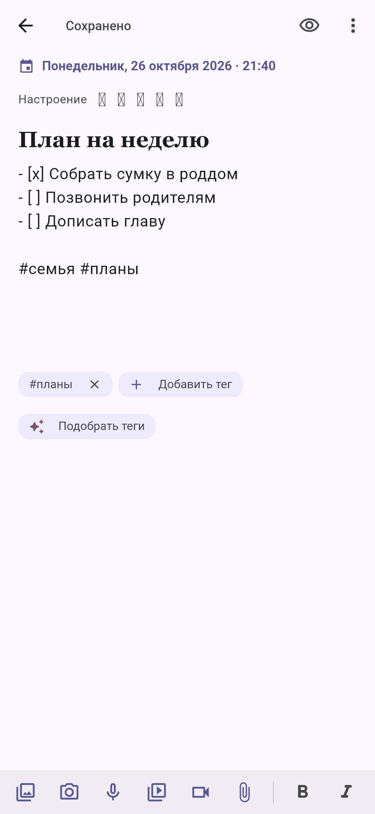
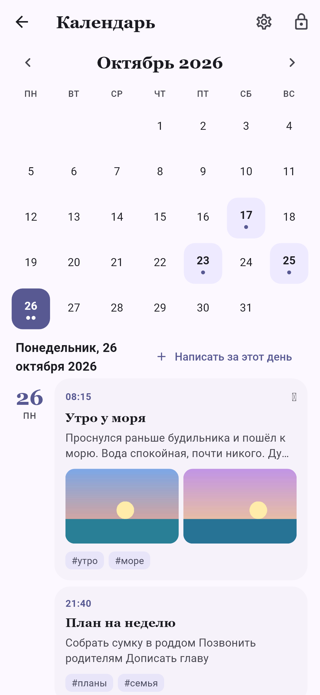
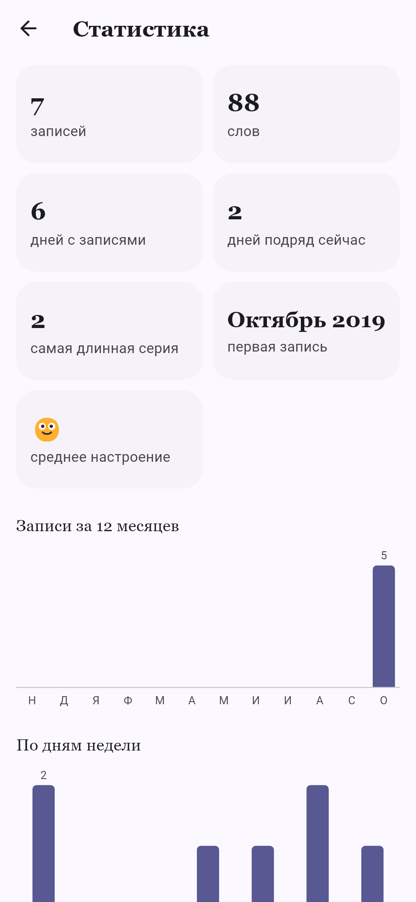
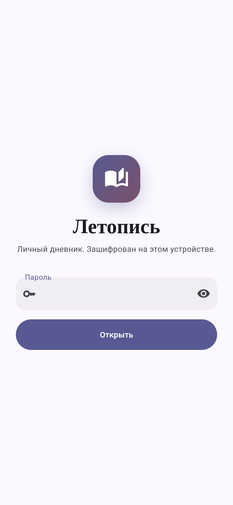
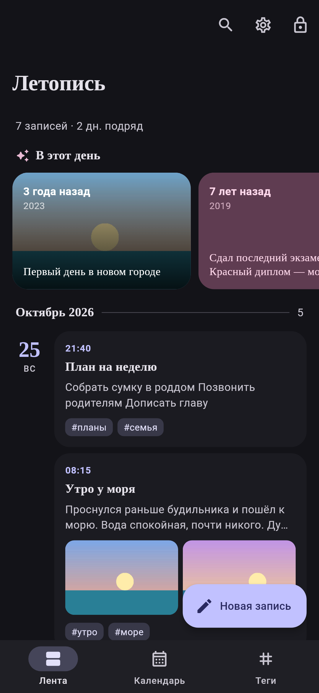

<div align="center">



[English](README.md) · **Русский**

[](https://letopis.recalltwin.com)
[](#скачать)

[](LICENSE)


</div>

**Летопись** — личный дневник для Android. Каждая запись — обычный Markdown со временем, тегами,
настроением и вложениями, и всё это зашифровано на телефоне ключом из вашего пароля. Без аккаунта,
без нашего облака, без рекламы и аналитики. Дневник остаётся вашим.

## Возможности

**Писать**
- Markdown с заголовками, цитатами и списками дел; время ставится само.
- Фото, видео, голосовые заметки и любые файлы прямо в записи.
- Настроение от 1 до 5; теги вручную, хэштегами или подсказкой нейросети, если захотите.

**Вспоминать**
- Лента карточками или плитками; «В этот день» показывает, что вы писали годы назад.
- Календарь, теги, поиск по тексту и статистика: дни подряд, слова, среднее настроение.
- Корзина хранит удалённое 30 дней, есть «Отменить».

**Приватность прежде всего**
- Шифрование AES-256-GCM, ключ из пароля через Argon2id. Без пароля файлы бесполезны.
- Автоблокировка, вход по отпечатку и запрет скриншотов — по желанию.
- В сеть приложение выходит, только когда вы просите: синхронизация с GitHub, ИИ-теги, проверка обновлений.

**Данные — как вам удобно**
- Синхронизация через ваше облако — Яндекс Диск, Облако Mail.ru, Nextcloud или любой сервер WebDAV — или
  приватный репозиторий GitHub (по желанию): зашифрованно, в обе стороны, между устройствами.
- Экспорт в PDF: книга для чтения и печати — даты, оформление, фото; целый год или одна запись.
- Импорт текстовой выгрузки дневника, MyDiary и файлов `.md`; экспорт всего в ZIP.
- 15 языков: русский, английский, китайский, хинди, испанский, арабский (справа налево), французский,
  бенгальский, португальский, индонезийский, урду, немецкий, японский, маратхи и вьетнамский.
- Семь шрифтов (классический, системный, с засечками, Lora, округлый, рукописный, моноширинный), светлая и
  тёмная темы, шесть цветов оформления.

## Скриншоты

<div align="center">
<table>
  <tr>
    <td></td>
    <td></td>
    <td></td>
    <td></td>
  </tr>
  <tr>
    <td></td>
    <td></td>
    <td></td>
    <td></td>
  </tr>
</table>
</div>

## Скачать

| Где | Статус | Android |
|---|---|---|
| **[letopis.recalltwin.com](https://letopis.recalltwin.com)** | ✅ последний APK; «Настройки → Проверить обновления» | 9 и новее |
| **RuStore** | 🔜 скоро | 7 и новее |
| **Google Play** | позже | 7 и новее |

Новая версия ставится поверх старой, записи сохраняются. Версии с сайта и из RuStore подписаны одним
ключом, между ними можно переходить.

> [!IMPORTANT]
> Пароль нельзя восстановить — в этом смысл шифрования. Храните его в надёжном месте.

## Как защищены данные

| | |
|---|---|
| **Шифрование** | Argon2id превращает пароль в ключ, который открывает случайный ключ данных; файлы — AES-256-GCM блоками по 1 МиБ |
| **На телефоне** | Записи, вложения, миниатюры, настройки и поисковый индекс — всё зашифровано |
| **Синхронизация** | В *вашу* папку в облаке или приватный репозиторий GitHub уходят те же зашифрованные файлы; текста они не видят |
| **Сеть** | Только ваше облако или GitHub, выбранный ИИ-сервис (только HTTPS, после согласия) и проверка обновлений — и всё по вашему действию |
| **Обновления** | Все сборки подписаны ключом, который хранится вне репозитория |

Модель угроз и известные ограничения: [SECURITY.ru.md](SECURITY.ru.md).

## Собрать самому

```bash
flutter pub get
flutter test
flutter build apk --release --flavor site    # или --flavor rustore / --flavor play
```

Для release-сборки нужен свой ключ подписи в `android/key.properties`. Подробно — устройство, варианты
сборки, подпись и ротация ключа, формат синхронизации — в [docs/DEVELOPMENT.md](docs/DEVELOPMENT.md).

## Участие

Ошибки и идеи — в [Issues](../../issues), пулл-реквесты тоже приветствуются. Правила — в
[AGENTS.md](AGENTS.md): не ослаблять шифрование, не хранить открытый текст на диске, ничего не отправлять
в сеть без действия пользователя. Нашли уязвимость — напишите на <sybberr@gmail.com>, а не в
публичный Issue.

## Лицензия

[GPL-3.0](LICENSE) с [дополнительным разрешением](LICENSE-EXCEPTION.md) на сборку с платёжной
библиотекой RuStore в версии для RuStore. © 2026 Александр Былинский.

---

<div align="center">

## ❤️ Поддержать автора

Летопись бесплатна: без рекламы, подписок и платных функций. Всё доступно всем и так и останется.
Если приложение вам полезно, можно сказать спасибо разовым платежом любой суммы.

[](https://pay.cloudtips.ru/p/16ad28d4)

В приложении: «Настройки → Поддержать проект». Платёж ничего не открывает — это просто спасибо.<br>
Помочь бесплатно: ⭐ поставить звезду репозиторию, рассказать другу, сообщить об ошибке.

</div>
